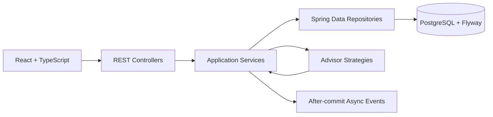

# StockPulse

StockPulse is an AI-assisted inventory and pricing console for small retail teams. It helps operators see stock health, process sales safely, and review pricing or replenishment recommendations before applying them.

The project is intentionally a small layered monolith: easy to run, easy to explain, and focused on reliable inventory changes rather than distributed infrastructure.

## ✨ Key features

- **Product management** — create, list, filter, and inspect products.
- **Stock tracking** — update stock and maintain active/out-of-stock status.
- **Safe order processing** — transactional stock deduction, pessimistic locking, idempotency keys, and immutable inventory snapshots.
- **Dynamic pricing suggestions** — deterministic rules with explicit `BigDecimal` rounding.
- **Reorder suggestions** — calculated quantities with duplicate-pending protection.
- **Optional AI advisor** — structured HTTP provider integration with validation and deterministic fallback.
- **Human approval** — suggestions remain `PENDING`; only approval changes price or stock.
- **Automatic triggers** — successful stock changes and orders asynchronously evaluate low-stock and demand-spike conditions after commit.
- **React console** — live product, sale, suggestion, and approval workflows with loading, empty, success, and error states.

## 🔎 How it works

Suppose a product has:

```text
Current price:       $20.00
Current stock:       4
Reorder threshold:   10
Demand velocity:     12
Category average:    5
```

Because stock `4 < 10`, StockPulse creates a pricing suggestion of `$22.00` (+10%) and a reorder suggestion of `max(1, 10 × 3 - 4) = 26` units. The low-stock rule wins even though demand is also high. Both suggestions stay pending until a person approves or rejects them.

## 🏗️ Architecture

StockPulse uses a Spring Boot layered monolith backed by PostgreSQL and a React/TypeScript frontend.



Why this design:

- **Layered monolith:** keeps boundaries clear without microservice overhead.
- **Transactions and locks:** prevent overselling and keep an order, stock change, and snapshot consistent.
- **Advisor boundary:** lets deterministic rules work without credentials while allowing an optional AI provider.
- **Human approval:** AI or rules can recommend, but never directly change inventory or prices.

## 📐 Business rules

Pricing is evaluated in this strict order:

1. If `currentStock < reorderThreshold`, recommend a **10% price increase**.
2. Otherwise, if `demandVelocity > 2 × categoryAverageDemandVelocity`, recommend a **5% price increase**.
3. Otherwise, recommend **HOLD**.

Price calculations use `BigDecimal` and `HALF_UP` rounding to two decimal places. Low stock always has priority over demand spikes.

Reorder quantity is:

```text
max(1, reorderThreshold * 3 - currentStock)
```

Suggestions are persisted as `PENDING`, `ACCEPTED`, or `REJECTED`. Generation never changes product data. Human approval is required; accepting a price suggestion updates the price, while accepting a reorder suggestion simulates inbound stock.

## 🧰 Technology stack

| Area | Technology |
|---|---|
| Backend | Java 17, Spring Boot 3.4.2 |
| API | Spring Web, Jakarta Bean Validation |
| Persistence | Spring Data JPA, PostgreSQL 16, Flyway |
| Operations | Spring Boot Actuator |
| Frontend | React 18, TypeScript, Vite |
| Testing | JUnit 5, Mockito, Spring Boot Test, H2 |
| Local database | Docker Compose with PostgreSQL |

## 📁 Project structure

```text
backend/src/main/java/com/stockpulse/
├── advisor/       deterministic rules and optional AI adapter
├── config/        CORS and async executor configuration
├── controller/    REST endpoints
├── dto/request/   validated request records
├── dto/response/  API response records
├── entity/        JPA entities and state transitions
├── event/         inventory events and listeners
├── exception/     API errors and exception advice
├── mapper/        entity-to-response conversion
├── repository/    Spring Data repositories and locks
├── seed/          opt-in demo data
└── service/       application workflows and transactions

frontend/src/
├── api/           backend request helpers
├── types/         TypeScript API models
└── App.tsx        dashboard workflow
```

## 🚀 Setup and execution

### Prerequisites

- Windows PowerShell
- JDK 17+ with `java` **and** `javac`
- Maven 3.9+
- Node.js 20+ and npm
- Docker Desktop, or a compatible PostgreSQL 16 instance

### Start PostgreSQL

From the repository root:

```powershell
cd C:\Users\Zycus\Downloads\stockpulse-starter\stockpulse
$env:DB_PASSWORD = "stockpulse_dev"
docker compose up -d postgres
```

The default development database is `stockpulse` on port `5432`, with username `stockpulse`. Set `DB_PASSWORD` before starting Docker if you want a different password.

### Configure and run the backend

The backend reads environment variables. The defaults are suitable for the included Docker Compose database except for the intentionally empty AI settings.

```powershell
cd C:\Users\Zycus\Downloads\stockpulse-starter\stockpulse\backend
$env:DB_URL = "jdbc:postgresql://localhost:5432/stockpulse"
$env:DB_USERNAME = "stockpulse"
$env:DB_PASSWORD = "stockpulse_dev"
$env:SERVER_PORT = "8080"
mvn spring-boot:run
```

To seed demo products once against an empty database:

```powershell
$env:APP_SEED_ENABLED = "true"
mvn spring-boot:run
```

Set `APP_SEED_ENABLED` back to `false` for normal runs. Flyway applies migrations automatically at startup.

### Run the frontend

In a second PowerShell window:

```powershell
cd C:\Users\Zycus\Downloads\stockpulse-starter\stockpulse\frontend
Copy-Item .env.example .env
npm.cmd install
npm.cmd run dev
```

Open `http://localhost:5173`. The backend listens on `http://localhost:8080` by default.

## ⚙️ Configuration

| Variable | Default | Purpose |
|---|---|---|
| `DB_URL` | `jdbc:postgresql://localhost:5432/stockpulse` | JDBC connection |
| `DB_USERNAME` | `stockpulse` | Database user |
| `DB_PASSWORD` | `stockpulse_dev` | Local development password; change outside local demos |
| `SERVER_PORT` | `8080` | Backend port |
| `CORS_ALLOWED_ORIGIN` | `http://localhost:5173` | Allowed frontend origin |
| `APP_SEED_ENABLED` | `false` | Opt-in demo seeding |
| `ADVISOR_PROVIDER` | `rule` | `rule` or `ai` |
| `ADVISOR_AI_ENDPOINT` | empty | AI HTTP endpoint when enabled |
| `ADVISOR_AI_API_KEY` | empty | AI credential, supplied only through environment |
| `ADVISOR_AI_TIMEOUT_MS` | `1500` | AI request timeout |
| `VITE_API_BASE_URL` | `http://localhost:8080/api/v1` | Frontend API base URL |

AI mode accepts either a JSON array or `{"suggestions":[...]}`. Invalid, missing, timed-out, non-success, or malformed AI responses fall back to deterministic rules.

## 🔌 API overview

All application routes use the `/api/v1` prefix.

| Area | Method and route | Purpose |
|---|---|---|
| Products | `POST /products` | Create a product |
| Products | `GET /products?status=&category=` | List and filter products |
| Products | `GET /products/{id}` | Get one product |
| Inventory | `PATCH /products/{id}/stock` | Update stock |
| Orders | `POST /orders` | Process an order |
| Orders | `POST /orders/products/{id}` | Product-scoped order alias |
| Snapshots | `GET /products/{id}/inventory-snapshots` | List inventory snapshots |
| Suggestions | `POST /products/{id}/suggestions?trigger=` | Generate suggestions |
| Suggestions | `GET /products/{id}/suggestions` | List suggestions |
| Suggestions | `POST /products/{id}/suggest-pricing` | Pricing alias |
| Suggestions | `POST /products/{id}/suggest-reorder` | Reorder alias |
| Approval | `PATCH /suggestions/{id}` | Approve or reject |
| Approval | `PATCH /pricing-suggestions/{id}` | Pricing compatibility alias |
| Approval | `PATCH /reorder-suggestions/{id}` | Reorder compatibility alias |
| Health | `GET /actuator/health` | Service health |

Example product request:

```json
{
  "sku": "SKU-APP-001",
  "name": "Organic Cotton T-Shirt",
  "category": "APPAREL",
  "currentPrice": 24.99,
  "stockLevel": 8,
  "reorderThreshold": 15,
  "demandVelocity": 12
}
```

Example order request:

```json
{
  "productId": "00000000-0000-0000-0000-000000000000",
  "quantity": 2,
  "idempotencyKey": "demo-order-001"
}
```

## ✅ Testing and build

Backend commands require a full JDK:

```powershell
cd C:\Users\Zycus\Downloads\stockpulse-starter\stockpulse\backend
mvn clean test
```

Frontend commands:

```powershell
cd C:\Users\Zycus\Downloads\stockpulse-starter\stockpulse\frontend
npm.cmd install
npm.cmd run build
npm.cmd run lint
```

The backend currently contains 11 test classes and 36 JUnit tests. In the authoring environment, Maven reached compilation but could not execute because `javac` was unavailable. Frontend build and lint have been executed successfully. No frontend test script is configured.

## ⚠️ Known limitations

- Backend compilation and tests require a full JDK; a JRE alone is insufficient.
- PostgreSQL and end-to-end smoke tests require Docker Desktop or a separately configured database.
- The AI provider contract is intentionally generic; deterministic rules remain the reliable default.
- Authentication, authorization, multi-product orders, payment, and fulfillment are outside the current scope.
- The repository is not connected to Git in this workspace.

## 🔭 Future work

- Add authentication and role-based approval permissions.
- Add frontend component tests and backend controller/integration tests once a full JDK/database environment is available.
- Add durable event delivery and operational retry metrics for asynchronous recommendations.

## License and contribution

This repository is a hackathon submission project. Keep credentials in environment variables and do not commit generated build output or local `.env` files.
